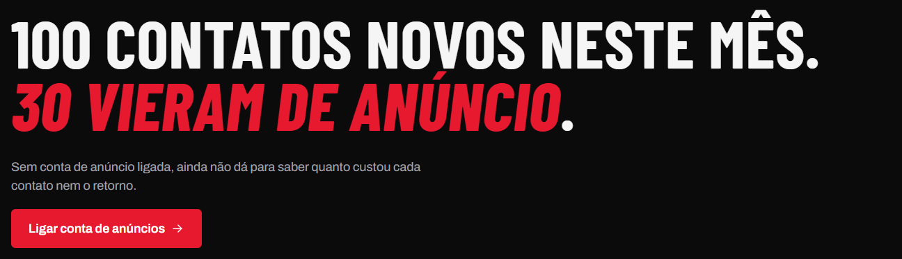
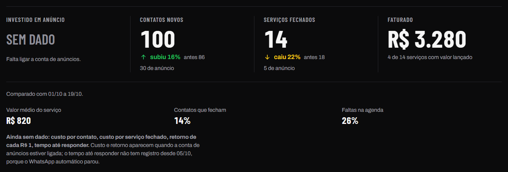
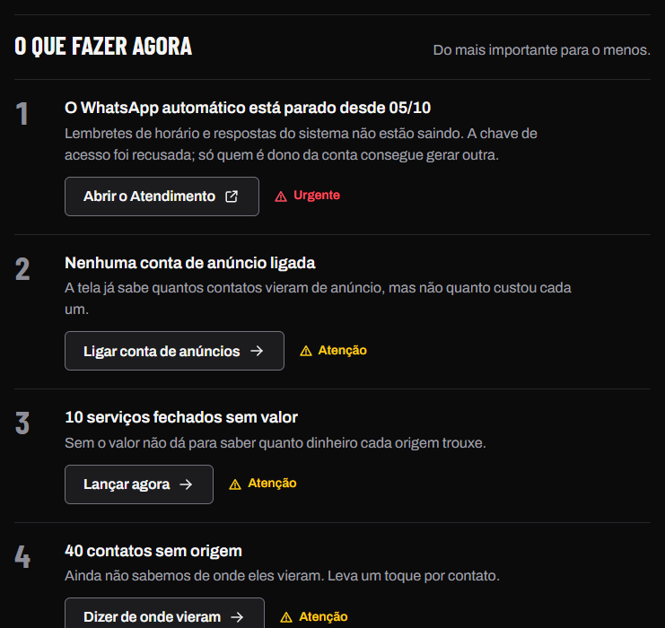
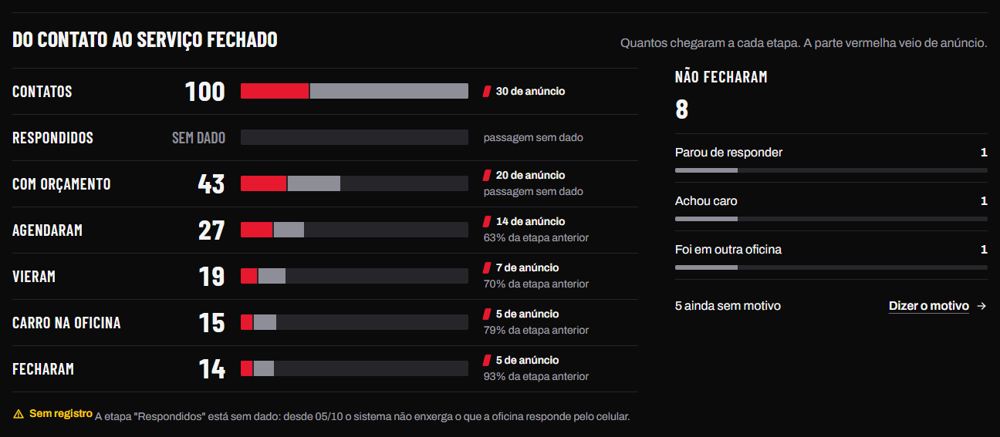
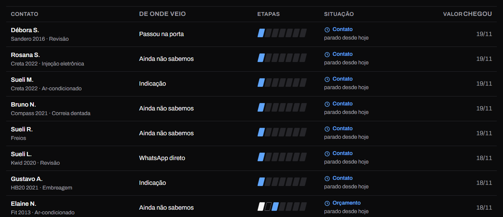
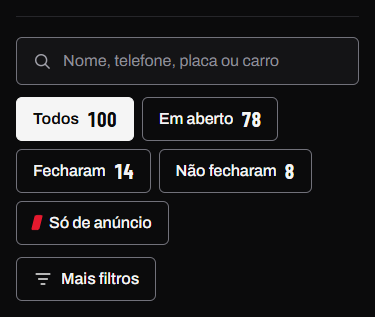
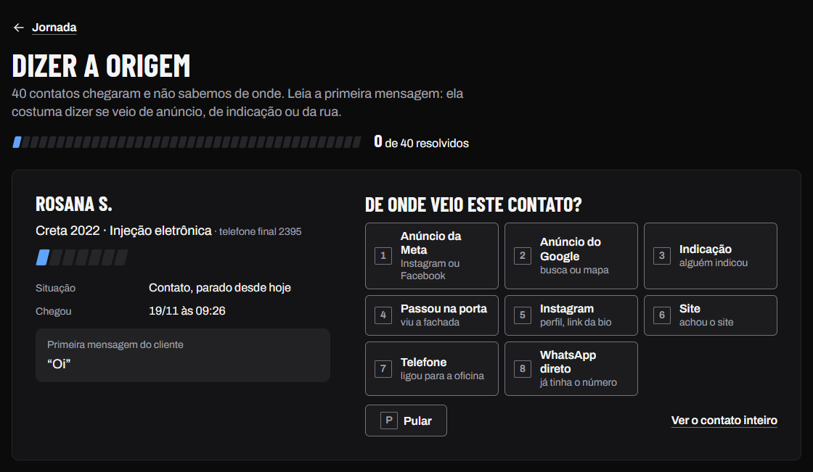
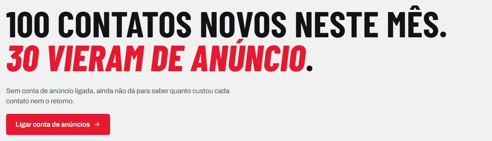

# Guia visual "Cronometragem" (IndyCar, rodada 8)

Sistema visual nascido na tela nova do IndyCar Tráfego e pensado para os outros apps do ecossistema
(Agenda, CRM, Atendimento, Comunicar, Pátio, Orçador) adotarem na rodada de repaginação. Nada aqui é
preso ao Tráfego: os nomes são de papel ("tinta", "marca", "setor"), não de tela.

Arquivos: `ds/tokens.css` (valores), `ds/base.css` (fontes, tipo, utilidades, movimento),
`ds/componentes.css` (peças). As telas do app (`css/casca.css`, `css/hoje.css`, `css/jornada.css`,
`css/espera.css`) só montam layout com essas peças.

As fotos abaixo ficam em `_guia/` e são refeitas por `GUIA=1 node tela/_mock/roteiro.mjs`
(servidor de mentira, cenário `sem_conta`, tema escuro, salvo onde diz outro).

## 1. A ideia em uma frase

A marca é de corrida. A tela fala a língua de uma **tela de tempos de corrida**: um número que se lê de
longe, uma torre de linhas com colunas fixas, mini-setores que acendem, intervalo ("parado há 3 dias").
A metáfora mora na **estrutura**, nunca em enfeite.

| Tela | Na corrida | O que faz |
|---|---|---|
| Hoje | muro dos boxes | uma frase enorme que responde a pergunta do dono, quatro números, o que fazer agora |
| Jornada | torre de tempos | uma linha por contato, mini-setores de etapa, filtros no polegar |
| Campanhas | classificação | campanhas em ordem, distância para a primeira (onda 2) |
| Gestor IA | engenheiro no rádio | fala curto, propõe, a pessoa aprova (onda 2) |

**Proibido**: bandeira quadriculada, velocímetro, ponteiro, volante, fumaça, carrinho, pizza, rosca, 3D,
brilho neon, gradiente roxo, emoji decorativo, cartão genérico com sombra, tudo centralizado, texto de marketing.

## 2. Tokens (três camadas)

1. **Primitivos** `--p-…`: o valor cru (`--p-vermelho-500`, `--p-esp-4`, `--p-letra-28`). Só `tokens.css` usa.
2. **Semânticos** `--cor-…`, `--tam-…`, `--esp-…`, `--mov-…`: o papel. **O tema troca só aqui.**
3. **De componente** `--botao-…`, `--torre-…`, `--setor-…`, `--barra-…`: ajuste fino de cada peça.

Fora de `tokens.css` não se escreve cor, tamanho de letra, espaço nem tempo na mão. Valor novo nasce lá,
com nome de papel.

### Cor

| Papel | Token | Escuro | Claro | Regra |
|---|---|---|---|---|
| chão | `--cor-fundo` | `#0b0b0c` | `#f1f1f2` | |
| painel | `--cor-superficie`, `--cor-superficie-2` | `#141416`, `#1c1c1f` | `#ffffff`, `#e6e6e9` | |
| texto | `--cor-tinta`, `--cor-tinta-2`, `--cor-tinta-3` | grafite 50, 400, 500 | grafite 980, 700, 650 | `tinta-3` só para o que pode sumir |
| linha | `--cor-linha`, `--cor-linha-forte` | grafite 800, 600 | grafite 300, 600 | `linha-forte` é borda de controle |
| **marca** | `--cor-marca`, `--cor-acao` | `#e6192e` | `#e6192e` | título, ação principal, logo, o que é "de anúncio" |
| marca em texto pequeno | `--cor-marca-texto` | `#ff4d5e` | `#c20f22` | vermelho pequeno em fundo escuro usa o tom claro |
| setor recorde | `--cor-setor-recorde` | roxo 300 | roxo 700 | sempre com a palavra "recorde" |
| setor bom | `--cor-setor-bom` | verde 500 | verde 800 | "melhorou", "em dia", "fechou" |
| setor atenção | `--cor-setor-atencao` | amarelo 400 | amarelo 800 | "atenção", "falta" |
| setor espera | `--cor-setor-espera` | azul 400 | azul 700 | "esperando", "em aberto" |
| grave | `--cor-grave` | `#ff4d5e` | `#c20f22` | problema sério: **sempre** com ícone de alerta e palavra |
| dado neutro | `--cor-dado`, `--cor-dado-trilho` | grafite 500, 800 | grafite 650, 300 | barra "do resto", trilho |
| casca | `--cor-casca…` | preto | preto | a barra do ecossistema é preta nos dois temas (o logo mora no preto) |

**Vermelho é a marca, não o erro.** Erro usa `--cor-grave` com o ícone `alerta` e a palavra ("Urgente",
"Chave recusada"). Estado nunca vai só na cor: o componente `selo` junta cor, ícone e palavra.

### Contraste (cobrado por `_testes/contraste.test.mjs`)

A tabela sai de `node tela/_testes/contraste.test.mjs --tabela`. Texto pede 4,5:1; marca gráfica pede 3:1.

| Par | Uso | Escuro | Claro | Mínimo |
|---|---|---|---|---|
| `--cor-tinta` sobre `--cor-fundo` | texto principal | 18,0:1 | 16,4:1 | 4,5:1 |
| `--cor-tinta` sobre `--cor-superficie` | texto em painel | 16,9:1 | 18,5:1 | 4,5:1 |
| `--cor-tinta` sobre `--cor-superficie-2` | texto em botão | 15,6:1 | 14,9:1 | 4,5:1 |
| `--cor-tinta-2` sobre `--cor-fundo` | texto de apoio | 7,7:1 | 6,8:1 | 4,5:1 |
| `--cor-tinta-2` sobre `--cor-superficie` | texto de apoio em painel | 7,2:1 | 7,7:1 | 4,5:1 |
| `--cor-tinta-3` sobre `--cor-fundo` | texto apagado | 6,1:1 | 5,3:1 | 4,5:1 |
| `--cor-marca-texto` sobre `--cor-fundo` | destaque vermelho em texto pequeno | 6,1:1 | 5,5:1 | 4,5:1 |
| `--cor-sobre-acao` sobre `--cor-acao` | botão principal | 4,6:1 | 4,6:1 | 4,5:1 |
| `--cor-setor-recorde` sobre `--cor-fundo` | selo "recorde" | 7,4:1 | 6,3:1 | 4,5:1 |
| `--cor-setor-bom` sobre `--cor-fundo` | selo "melhorou" / "em dia" | 8,6:1 | 6,3:1 | 4,5:1 |
| `--cor-setor-atencao` sobre `--cor-fundo` | selo "atenção" | 12,8:1 | 5,3:1 | 4,5:1 |
| `--cor-setor-espera` sobre `--cor-fundo` | selo "esperando" | 7,7:1 | 5,9:1 | 4,5:1 |
| `--cor-grave` sobre `--cor-fundo` | selo de problema grave | 6,1:1 | 5,5:1 | 4,5:1 |
| `--cor-setor-bom` sobre `--cor-superficie` | selo em painel | 8,1:1 | 7,1:1 | 4,5:1 |
| `--cor-setor-atencao` sobre `--cor-superficie` | selo em painel | 12,0:1 | 5,9:1 | 4,5:1 |
| `--cor-marca` sobre `--cor-fundo` | paralelogramo e barra "de anúncio" | 4,3:1 | 4,1:1 | 3:1 |
| `--setor-feito` sobre `--setor-vazio` | mini-setor cumprido contra o vazio | 13,8:1 | 12,6:1 | 3:1 |
| `--cor-dado` sobre `--cor-dado-trilho` | barra de dado no trilho | 4,6:1 | 4,0:1 | 3:1 |
| `--cor-linha-forte` sobre `--cor-fundo` | borda de botão e campo | 4,1:1 | 4,3:1 | 3:1 |
| `--cor-foco` sobre `--cor-fundo` | anel de foco | 18,0:1 | 16,4:1 | 3:1 |
| `--cor-casca-tinta` sobre `--cor-casca` | barra do ecossistema | 19,3:1 | 19,3:1 | 4,5:1 |
| `--cor-casca-tinta-2` sobre `--cor-casca` | barra do ecossistema, apoio | 8,2:1 | 8,2:1 | 4,5:1 |

### Tipo

| Papel | Família | Tamanho | Regra |
|---|---|---|---|
| frase principal | Barlow Condensed 700, caixa alta | `--tam-frase` 40 a 112 px (`clamp`), `-m` e `-p` para frase comprida | entrelinha `--altura-titulo` 0,94; destaque em `em.destaque` (vermelho itálico 800) |
| número de resumo | Barlow Condensed 700 | `--tam-numero` 32 a 64 px | `font-variant-numeric: tabular-nums` sempre |
| título de tela, de bloco, pequeno | Barlow Condensed 700/600 | 44, 28, 20 px | caixa alta |
| rótulo | Barlow Condensed 600 | 16 px | caixa alta, `--tracado-rotulo` 0,06em |
| texto | Archivo (variável) | 16 px, 18 px no texto grande, 14 px só em apoio | entrelinha 1,5; medida `--medida-texto` 62ch |

Fontes servidas do próprio app (`fontes/*.woff2`), nenhum domínio de fora. Prosa com número (a frase
principal) usa algarismo proporcional; tabela e placar usam tabular.

### Espaço, raio, movimento

- Espaço: base de 4 px (`--p-esp-1` a `--p-esp-20`); papéis `--esp-pagina`, `--esp-bloco`, `--esp-grupo`, `--esp-item`, `--esp-junto`.
- Alvo de toque: `--alvo` 44 px. Botão, ficha, segmento, linha da torre e item de menu respeitam.
- Raio: `--raio-marca` 2 px (setor, barra, paralelogramo), `--raio-controle` 6 px, `--raio-painel` 10 px.
- Movimento: 150, 220 e 300 ms com `--curva-saida`. **Só quando o dado muda**, nada em laço, tudo atrás de
  `prefers-reduced-motion: no-preference`. Assinaturas permitidas: os mini-setores acendem em fila na primeira
  carga; o número principal "crava" quando muda.
- `--inclinacao: -14deg` é o ângulo do paralelogramo do logo. Só setores, barra "de anúncio" e marcas usam.

## 3. Componentes

| Peça | Classe | Quando usar |
|---|---|---|
| botão | `.botao`, `.botao-forte` (ação principal, vermelho), `.botao-quieto`, `.botao-g`, `.botao-icone` | um `.botao-forte` por bloco, no máximo |
| campo | `.campo`, `.campo-rotulo`, `.entrada`, `.entrada-valor`, `.campo-erro`, `.busca` | rótulo sempre visível; erro em frase de gente |
| ficha | `.fichas` > `.ficha` com `.ficha-n` | filtro de um toque, com a contagem |
| segmentos | `.segmentos` > `.segmento` (`role=radio`) | uma escolha entre até 5 (período) |
| selo | `.selo.tom-bom` etc. | estado com ícone e palavra; nunca só cor |
| mini-setores | `.setores` > `.setor[data-estado][data-tom]` | os sete tracinhos da jornada de um contato |
| torre | `.torre` > `.torre-cabeca` + `.torre-linha` > `.torre-celula`; `.torre-abre` estica o link na linha | lista densa com colunas fixas; no celular cada linha vira ficha de 44 px ou mais |
| número | `.numero-bloco`, `.numero`, `.comparacao` | um número por bloco, comparação por extenso ("subiu 16%") |
| barras e colunas | `.barra` (com `i.de-marca`), `.colunas`, `.grafico-leitura` | só barra e linha; rótulo direto no dado |
| ações | `.acoes` > `.acao` (`.acao-ordem`, `.acao-titulo`, `.acao-porque`, `.acao-pe`) | "o que fazer agora", já em ordem |
| faixa | `.faixa` | aviso na largura da página (demonstração, servidor acordando, sem internet) |
| toast | `.toast` com `.toast-tempo` | confirmação curta e o "desfazer" de 5 segundos |
| menu | `.menu`, `.menu-item`, `.menu-quem` | troca de app e conta |
| estados | `.esq` (esqueleto com a forma da tela), `.vazio`, `.falha` | carregando, vazio e erro são três telas diferentes |
| marca "de anúncio" | `.marca-anuncio` | paralelogramo vermelho antes do nome da origem paga |

### Fotos

| | |
|---|---|
| Frase principal (`sem_conta`)  | Quatro números  |
| O que fazer agora  | Do contato ao serviço fechado  |
| Torre com mini-setores  | Filtros no polegar (375 px)  |
| Mutirão de pendências  | Tema claro  |

## 4. Regras de texto (vale para qualquer app)

- Português do Brasil, frase curta, para dono de oficina. Palavras da casa: "contato", "custo por contato",
  "serviço fechado", "retorno", "carro".
- Proibido: travessão em texto de tela, "lead", "ROAS", "CPA", "CTR", "dashboard", "insight", "prezado",
  "efetuar", "comparecer", "veículo". Sigla só com a tradução ao lado. O roteiro de navegador procura esses textos.
- "Não sei" é `null` e vira palavra ("sem dado", com o porquê ao lado). Nunca zero, nunca traço.
- Texto de cliente (nome, mensagem) entra por `textContent` (`h()` de `js/dom.js`), nunca `innerHTML`.

## 5. Regras de montagem

- `[hidden]{display:none!important}`; grades com `minmax(0,1fr)`; nada de rolagem lateral em 320 px.
- Política de segurança: sem `style` nem `script` embutido no HTML, sem `eval`, sem recurso de fora. Largura de
  barra vai por variável no atributo `style` (`--v`), que a política permite.
- Tema: escuro é o padrão do Tráfego; claro com `<html data-tema="claro">`, chave `indycar_tema` (a mesma da Casa),
  lida antes de pintar por `tema.js`.
- Endereço sempre relativo (o app mora em `/trafego/`).

## 6. Como adotar em outro app

1. Copie `ds/` e `fontes/` para o app (ou sirva da Central) e carregue `tokens.css`, `base.css`, `componentes.css` nessa ordem.
2. Troque as cores próprias do app pelos tokens semânticos; se faltar um papel, crie em `tokens.css`, não no app.
3. Comece pela casca (barra preta do ecossistema) e pelos estados (esqueleto, vazio, falha); depois as telas.
4. Rode o teste de contraste e um roteiro de navegador como `_mock/roteiro.mjs` (1440 e 375 px, escuro e claro, axe-core).
